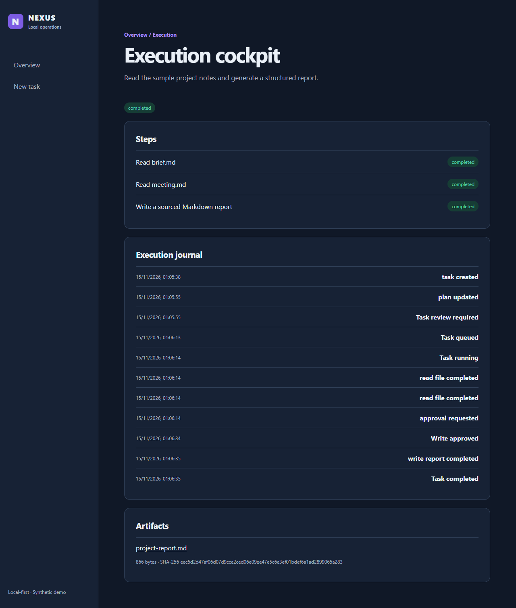
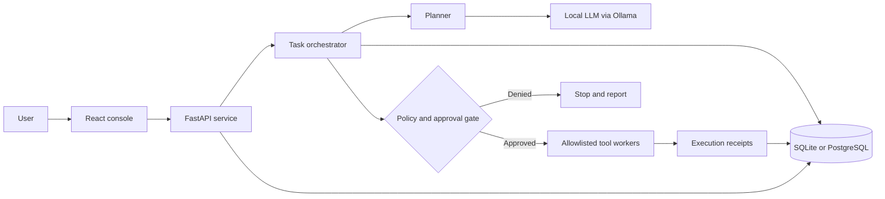

<div align="center">

# NEXUS

### A controlled workspace for local-first autonomous AI workflows.

**AI orchestration · Python · FastAPI · React · TypeScript · Ollama**

  

[Overview](#overview) · [Features](#planned-capabilities) · [Architecture](#architecture) · [Data & APIs](#data-model-and-api-contract) · [Roadmap](#roadmap)

</div>

---

## Overview

NEXUS is a proposed personal AI operations console: users define an objective, review an execution plan, approve sensitive actions, and inspect an evidence-backed record of what the agent actually did. It is designed to make agentic workflows **auditable and controllable**, rather than giving a model unrestricted access to a machine.


---

## Project status

> **Working local demo in development** — The API persists tasks and reviewable plans. A separate worker reads bounded local text files, requests approval before writing a report, and records artifacts and events. This is an early MVP with documented limits, not a finished v1. See [development status](docs/DEVELOPMENT_STATUS.md) and [local setup](docs/development.md).

### Verified local demo

The screenshots below come from a synthetic two-note workflow run in a local
browser. An approved write produced a Markdown report; a second run was
rejected and produced no artifact.




## Design principles

- **Local-first and cost-aware:** development should be possible with free/open-source tooling and without paid API subscriptions.
- **Secure by default:** least privilege, explicit trust boundaries, secret redaction, and safe defaults.
- **Reliable by design:** predictable state transitions, useful error messages, idempotent operations where applicable, and observable failures.
- **Honest engineering:** reproducible demos and tests; no fabricated measurements or feature-complete badges.
- **Accessible interfaces:** responsive layouts, keyboard navigation, legible contrast and helpful empty states.


## Planned capabilities

| Capability | Intended behaviour |
| --- | --- |
| Task composer | Define goals, constraints, attachments and success criteria |
| Planning engine | Break work into bounded steps with explicit dependencies |
| Tool registry | Allowlisted tools with typed inputs, output schemas and capability scopes |
| Approval gates | Pause before filesystem writes, network access or other sensitive actions |
| Execution timeline | Show step statuses, tool calls, results, retries and elapsed time |
| Workspace memory | Keep user-approved notes and searchable task history with deletion controls |
| Recovery | Resume safe tasks after restarts without repeating side effects |
| Evidence view | Link outcomes to source artifacts and tool receipts |

## Architecture

The diagram below is a **target architecture** and may evolve through documented architecture decision records (ADRs).



### Core workflow

1. The user submits an objective and selects allowed capabilities.
2. The planner proposes bounded, reviewable steps; the service validates the plan shape.
3. The orchestrator schedules steps and persists state before execution.
4. Each tool request is checked against allowlists, parameter schemas and user-approved scopes.
5. Sensitive actions stop at a visible approval gate. Rejection is a normal, recorded outcome.
6. Workers return typed results and receipts, and retries respect idempotency boundaries.
7. The console presents outputs, limitations, failures and the full execution timeline.

### Proposed technology stack

| Layer | Proposed choice | Rationale |
| --- | --- | --- |
| UI | React + TypeScript + Vite | Fast, typed and component-driven |
| API | Python + FastAPI + Pydantic | Typed request and tool contracts |
| Local inference | Ollama with a compatible local model | No compulsory per-token charges |
| Persistence | SQLite for MVP; PostgreSQL optional | Simple local setup with upgrade path |
| Async work | Durable DB-backed queue initially | Avoid unnecessary infrastructure |
| Tests | Pytest, Vitest, Playwright | Coverage of tools, API and user flows |

## Data model and API contract

The following are **draft entities and endpoint shapes** to guide implementation. They are not deployed APIs.

### Primary data entities

- `tasks`: `id`, `goal`, `status`, `created_at`, `updated_at`, `owner_id`
- `steps`: `id`, `task_id`, `sequence`, `kind`, `status`, `retry_count`, `idempotency_key`
- `tool_calls`: `id`, `step_id`, `tool_name`, `input_digest`, `status`, `result_ref`
- `approvals`: `id`, `tool_call_id`, `scope`, `decision`, `decided_at`
- `artifacts`: `id`, `task_id`, `path_or_uri`, `sha256`, `created_at`
- `audit_events`: append-only event envelopes with correlation IDs and redaction

### Planned HTTP interface

```http
POST /api/v1/tasks
GET  /api/v1/tasks/{task_id}
GET  /api/v1/tasks/{task_id}/events
POST /api/v1/tasks/{task_id}/cancel
POST /api/v1/approvals/{approval_id}/decision
GET  /api/v1/tools
```

All mutation endpoints require authenticated user intent. Approval decisions include a specific pending action, not blanket permanent consent.

## Security and privacy

**Non-negotiable trust boundaries:** model output is untrusted input; prompt injection cannot grant tool permissions; tools never receive raw blanket OS access. Restrict file paths to a workspace, deny arbitrary shell execution by default, gate outbound network access, redact secrets in logs and persist approval decisions. A kill switch must block queued and new tool actions.

## User journey

**Planned local workflow (after implementation):** install reviewed prerequisites from official sources, configure a local Ollama model, set up the API and web client using documented example environment variables, launch both services, open the local dashboard, submit a task, review its proposed plan, and approve or reject scoped actions. The actual installation commands will be published and tested with the first working release.

## Expected repository structure

```text
nexus/
├── apps/web/                 # React user interface
├── services/api/             # FastAPI endpoints
├── services/worker/          # Task orchestration and tool execution
├── packages/contracts/       # Shared schemas and protocol specs
├── tests/                    # Unit, integration and E2E tests
├── docs/                     # Architecture, ADRs and threat model
├── .github/workflows/        # CI checks
└── README.md
```

## Definition of done — first working release

- A task can be submitted and is persisted across a service restart.
- The planner returns schema-valid, bounded steps from a local model or deterministic test fixture.
- An unapproved write action does not execute; a rejection is recorded.
- A repeated request does not duplicate a completed side effect.
- A task can be cancelled and its full timeline inspected.
- The demo runs without paid AI API keys.


## Engineering standards

| Area | Standard |
| --- | --- |
| Version control | Small, descriptive commits to `main` during solo development |
| Quality | Linting, formatting, type checks, unit tests and integration tests |
| Documentation | Architecture decisions, API examples, threat model and setup instructions |
| Security | No credentials in Git; dependency review; input validation; least-privilege defaults |
| Demos | Clearly labelled synthetic/fixture data where used; no misleading production claims |
| Budget | R0 target for tools and service subscriptions; cloud deployment is optional |

## Roadmap

- [ ] **Foundation:** repository structure, developer setup, linting and CI
- [ ] **Core:** implement the primary workflow end-to-end with deterministic fixtures
- [ ] **Reliability:** input validation, state/error handling, security controls and automated tests
- [ ] **Experience:** responsive dashboard, accessibility and understandable feedback
- [ ] **Release:** documented local demo, screenshots, reproducible test results and v0.1.0 tag

## Contributing

This is initially a solo portfolio project. Suggestions and thoughtful issues are welcome once development begins. Before opening a pull request, explain the problem, proposed change, tests and any security impact.

## Maintainer

Built by **[Christopher Doyle](https://github.com/Christopher-Doyle)** as part of a four-project December 2026 engineering portfolio series.

## Licence

A licence has **not yet been selected**. Until a licence file is added, please do not assume permission to reuse or redistribute the code. The README and project plan are provided for viewing.
