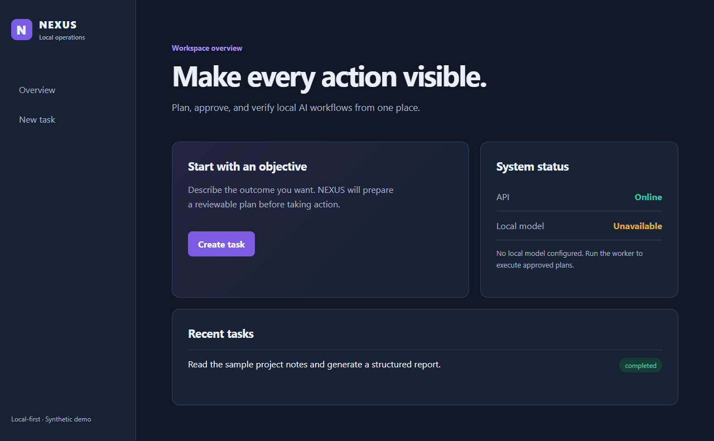
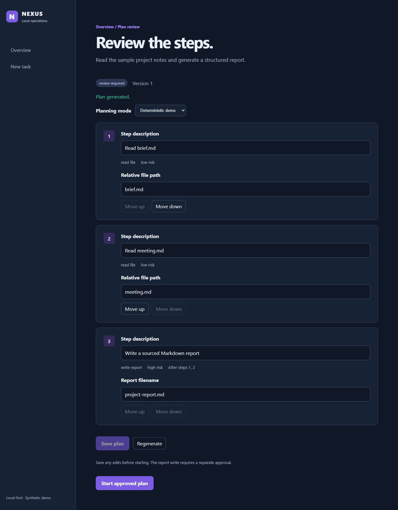
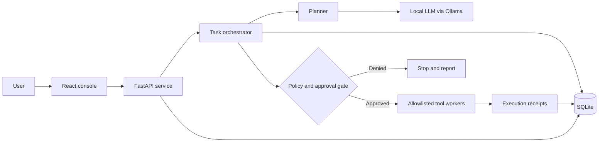

<div align="center">

# NEXUS

### A controlled workspace for local-first autonomous AI workflows.

**AI orchestration · Python · FastAPI · React · TypeScript · Ollama**

  

[Overview](#overview) · [Features](#implemented-capabilities) · [Run locally](#run-locally) · [Architecture](#architecture) · [Roadmap](#roadmap)

</div>

---

## Overview

NEXUS is a local personal AI operations console: users define an objective, review an execution plan, approve sensitive actions, and inspect an evidence-backed record of what the agent actually did. The working demo uses a permission-gated file reader, local text search, and Markdown report writer. A bounded public HTTPS text fetch is available only when a task opts in and the exact action is approved. Ollama planning is optional; the installed local `qwen3.5:9b` model completed an opt-in browser workflow through plan review, supervised execution and report approval.


---

## Project status

> **Working local demo in development** — Tasks, plans, approvals, journals and artifacts persist in SQLite. A supervised worker runs four allowlisted tools with bounded timeouts and exact approval for writes and opt-in HTTPS fetch. The cockpit shows receipts and report recovery. History exports task records; inactive tasks can be deleted, and terminal-task retention is optional. The artifact library previews and compares verified reports. Automated backend, frontend and browser checks cover the local workflow. One owner-approved public HTTPS fetch completed through the task and approval path. Manual assistive technology review and other [release gates](docs/release-checklist.md) remain open. See [development status](docs/DEVELOPMENT_STATUS.md), [v1 requirement matrix](docs/v1-requirement-matrix.md), [security review](docs/security-audit.md) and [changelog](CHANGELOG.md).

### Verified local demo

The screenshots below come from a synthetic two-note workflow run in a local
browser. An approved write produced a Markdown report; a second run was
rejected and produced no artifact.





## Design principles

- **Local-first and cost-aware:** development should be possible with free/open-source tooling and without paid API subscriptions.
- **Secure by default:** least privilege, explicit trust boundaries, secret redaction, and safe defaults.
- **Reliable by design:** predictable state transitions, useful error messages, idempotent operations where applicable, and observable failures.
- **Honest engineering:** reproducible demos and tests; no fabricated measurements or feature-complete badges.
- **Accessible interfaces:** responsive layouts, keyboard navigation, legible contrast and helpful empty states.


## Implemented capabilities

| Capability | Current behaviour |
| --- | --- |
| Task composer | Goals, constraints, success criteria and bounded text attachments or approved folders |
| Planning | Deterministic demo or optional local Ollama plan with a concise/detailed prompt setting; numbered steps can be edited before execution |
| Tool registry | Four allowlisted tools with typed schemas, grants, timeouts and retry policy |
| Approval gates | Exact action approval for report writes and opt-in public HTTPS text fetches |
| Execution cockpit | Persisted status, events, receipts, approvals, pause, resume and cancellation |
| History and retention | Searchable task history, cursor-paged journal export, confirmed deletion and optional age-based cleanup |
| Recovery | Safe read retries and exact report-file reconciliation after uncertain writes |
| Evidence | Cited Markdown reports, verified artifact preview and download |

## Run locally

Requires Python 3.12+, Node.js 22+, uv and npm. From `services/api`, run
`uv sync --extra dev`, create the `data` directory, run
`uv run alembic upgrade head`, then start
`uv run uvicorn app.main:app --host 127.0.0.1 --port 8765`. In a second
terminal there, run `uv run python -m app.worker`. From `apps/web`, run
`npm ci` and `npm run dev`; open `http://127.0.0.1:5173`. The complete
[setup guide](docs/development.md) covers local models, folder grants, tests
and the isolated browser demo. No paid service or model download is required.

## Architecture

The diagram below shows the current local architecture. See [architecture details](docs/architecture.md) and the [ADRs](docs/adr).



### Core workflow

1. The user submits an objective and selects allowed capabilities.
2. The planner proposes bounded, reviewable steps; the service validates the plan shape.
3. The orchestrator schedules steps and persists state before execution.
4. Each tool request is checked against allowlists, parameter schemas and user-approved scopes.
5. Sensitive actions stop at a visible approval gate. Rejection is a normal, recorded outcome.
6. Workers return typed results and receipts, and retries respect idempotency boundaries.
7. The console presents outputs, limitations, failures and the full execution timeline.

### Current technology stack

| Layer | Choice | Rationale |
| --- | --- | --- |
| UI | React + TypeScript + Vite | Fast, typed and component-driven |
| API | Python + FastAPI + Pydantic | Typed request and tool contracts |
| Local inference | Ollama with a compatible local model | No compulsory per-token charges |
| Persistence | SQLite | Simple local setup with explicit migrations |
| Async work | Durable DB-backed queue initially | Avoid unnecessary infrastructure |
| Tests | Pytest, Vitest, Playwright | Coverage of tools, API and user flows |

## Data model and API contract

The current database schema is managed by Alembic migrations. The HTTP routes
that exist today are listed in the [API reference](docs/api.md).

### Primary data entities

`Task`, `PlanStep`, `Execution`, `Approval`, `Event`, `Artifact`, and
`WorkerHeartbeat` are persisted in SQLite. A task carries its capability
grant and plan version; an approval is bound to exact step arguments.

The loopback API requires an explicit intent header for mutations. This is a
single-owner local boundary, not remote authentication.

## Security and privacy

**Non-negotiable trust boundaries:** model output is untrusted input; prompt injection cannot grant tool permissions; tools never receive raw blanket OS access. Restrict file paths to a workspace, deny arbitrary shell execution by default, gate outbound network access, redact secrets in logs and persist approval decisions. A kill switch must block queued and new tool actions.

## User journey

For the working demo, follow [local setup](docs/development.md), launch the API,
worker and web client, create a task, generate the deterministic plan, review
it, start execution, and approve or reject the scoped report write. The model
remains optional. A task can separately opt into a bounded public HTTPS text
fetch, which requires exact approval before the worker connects. One
owner-approved request to `https://example.com/` completed in an isolated
NEXUS task. Routine browser tests still use mocked connections.

See the [user guide](docs/user-guide.md), [operations and backup](docs/operations.md),
[troubleshooting](docs/troubleshooting.md), [security policy](SECURITY.md) and
[release checklist](docs/release-checklist.md) for current behavior and gates.

## Repository structure

```text
NEXUS/
├── apps/web/                 # React user interface and Vitest checks
├── services/api/             # FastAPI, worker, migrations and Pytest checks
├── fixtures/demo/            # Synthetic local demo inputs
├── docs/                     # Status, architecture, security and screenshots
├── .github/workflows/        # CI checks
└── README.md
```

## Engineering standards

| Area | Standard |
| --- | --- |
| Version control | Small, descriptive commits to `main` during solo development |
| Quality | Linting, formatting, type checks, unit tests and integration tests |
| Documentation | Architecture decisions, API examples, threat model and setup instructions |
| Security | No credentials in Git; dependency review; input validation; least-privilege defaults |
| Demos | Clearly labelled synthetic/fixture data where used; no misleading production claims |
| Budget | R0 target for tools and service subscriptions; cloud deployment is optional |

## Roadmap

- [x] **Foundation:** repository structure, developer setup, linting and CI
- [x] **Core demo:** implement the primary workflow end-to-end with deterministic fixtures
- [x] **Reliability baseline:** input validation, recovery, bounded tools and automated tests
- [x] **Experience baseline:** responsive dashboard, mobile navigation, keyboard path and automated WCAG checks
- [ ] **Release:** complete remaining security, manual accessibility and verification gates before a versioned release

## Contributing

See [CONTRIBUTING.md](CONTRIBUTING.md) for local setup and checks. Explain the problem, proposed change, tests and any security impact before opening a pull request.

## Maintainer

Built by **[Christopher Doyle](https://github.com/Christopher-Doyle)** as part of a four-project December 2026 engineering portfolio series.

## Licence

A licence has **not yet been selected**. Until a licence file is added, please do not assume permission to reuse or redistribute the code. The README and project plan are provided for viewing.
