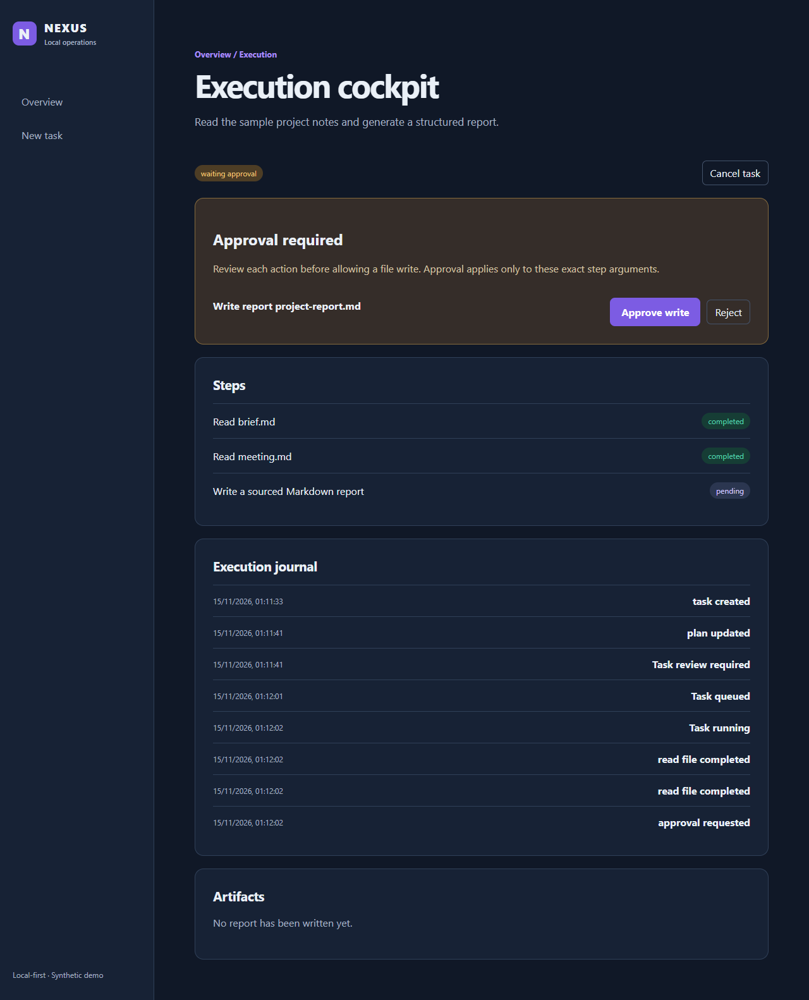
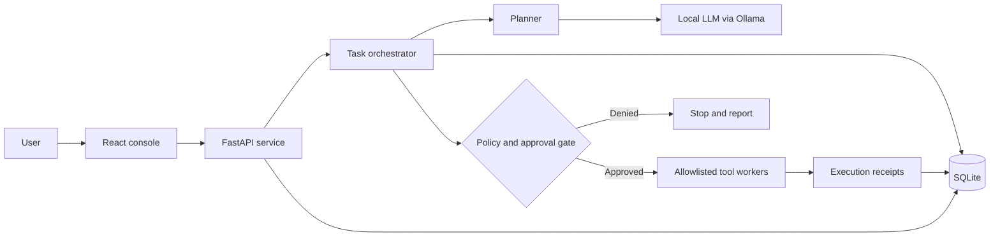

<div align="center">

# NEXUS

### A controlled workspace for local-first autonomous AI workflows.

**AI orchestration · Python · FastAPI · React · TypeScript · Ollama**

  

[Overview](#overview) · [Features](#planned-capabilities) · [Architecture](#architecture) · [Data & APIs](#data-model-and-api-contract) · [Roadmap](#roadmap)

</div>

---

## Overview

NEXUS is a local personal AI operations console: users define an objective, review an execution plan, approve sensitive actions, and inspect an evidence-backed record of what the agent actually did. The working demo uses a permission-gated file reader, local text search, and Markdown report writer. Ollama planning is optional; the adapter has been verified with an installed local `qwen3.5:9b` model, while the browser journey remains to be tested.


---

## Project status

> **Working local demo in development** — The API persists tasks and reviewable plans. A supervised worker reads and searches selected local text files, requests approval before writing a report with source citations, and enforces bounded tool execution. The cockpit shows persisted tool receipts and can resolve uncertain report writes. History can export each task's metadata, journal, receipts and artifact metadata as JSON; inactive tasks can be deleted with exact confirmation. Local model and timeout preferences can be edited in Settings. An isolated Playwright test covers approved and rejected demo runs. This is an early MVP with documented limits. See [development status](docs/DEVELOPMENT_STATUS.md), [P0 traceability](docs/requirements.md), [security review](docs/security-audit.md), [local setup](docs/development.md), and [changelog](CHANGELOG.md).

### Verified local demo

The screenshots below come from a synthetic two-note workflow run in a local
browser. An approved write produced a Markdown report; a second run was
rejected and produced no artifact.





## Design principles

- **Local-first and cost-aware:** development should be possible with free/open-source tooling and without paid API subscriptions.
- **Secure by default:** least privilege, explicit trust boundaries, secret redaction, and safe defaults.
- **Reliable by design:** predictable state transitions, useful error messages, idempotent operations where applicable, and observable failures.
- **Honest engineering:** reproducible demos and tests; no fabricated measurements or feature-complete badges.
- **Accessible interfaces:** responsive layouts, keyboard navigation, legible contrast and helpful empty states.


## Planned capabilities

| Capability | Intended behaviour |
| --- | --- |
| Task composer | Define goals, constraints, attachments and success criteria |
| Planning engine | Break work into bounded steps with explicit dependencies |
| Tool registry | Allowlisted tools with typed inputs, output schemas and capability scopes |
| Approval gates | Pause before filesystem writes, network access or other sensitive actions |
| Execution timeline | Show step statuses, tool calls, results, retries and elapsed time |
| Workspace memory | Keep user-approved notes and searchable task history with deletion controls |
| Recovery | Resume safe tasks after restarts without repeating side effects |
| Evidence view | Link outcomes to source artifacts and tool receipts |

## Architecture

The diagram below shows the current local architecture. See [architecture details](docs/architecture.md) and the [ADRs](docs/adr).



### Core workflow

1. The user submits an objective and selects allowed capabilities.
2. The planner proposes bounded, reviewable steps; the service validates the plan shape.
3. The orchestrator schedules steps and persists state before execution.
4. Each tool request is checked against allowlists, parameter schemas and user-approved scopes.
5. Sensitive actions stop at a visible approval gate. Rejection is a normal, recorded outcome.
6. Workers return typed results and receipts, and retries respect idempotency boundaries.
7. The console presents outputs, limitations, failures and the full execution timeline.

### Current technology stack

| Layer | Choice | Rationale |
| --- | --- | --- |
| UI | React + TypeScript + Vite | Fast, typed and component-driven |
| API | Python + FastAPI + Pydantic | Typed request and tool contracts |
| Local inference | Ollama with a compatible local model | No compulsory per-token charges |
| Persistence | SQLite | Simple local setup with explicit migrations |
| Async work | Durable DB-backed queue initially | Avoid unnecessary infrastructure |
| Tests | Pytest, Vitest, Playwright | Coverage of tools, API and user flows |

## Data model and API contract

The current database schema is managed by Alembic migrations. The HTTP routes
that exist today are listed in the [API reference](docs/api.md).

### Primary data entities

`Task`, `PlanStep`, `Execution`, `Approval`, `Event`, `Artifact`, and
`WorkerHeartbeat` are persisted in SQLite. A task carries its capability
grant and plan version; an approval is bound to exact step arguments.

The loopback API requires an explicit intent header for mutations. This is a
single-owner local boundary, not remote authentication.

## Security and privacy

**Non-negotiable trust boundaries:** model output is untrusted input; prompt injection cannot grant tool permissions; tools never receive raw blanket OS access. Restrict file paths to a workspace, deny arbitrary shell execution by default, gate outbound network access, redact secrets in logs and persist approval decisions. A kill switch must block queued and new tool actions.

## User journey

For the working demo, follow [local setup](docs/development.md), launch the API,
worker and web client, create a task, generate the deterministic plan, review
it, start execution, and approve or reject the scoped report write. The model
remains optional and network access is disabled.

## Repository structure

```text
NEXUS/
├── apps/web/                 # React user interface and Vitest checks
├── services/api/             # FastAPI, worker, migrations and Pytest checks
├── fixtures/demo/            # Synthetic local demo inputs
├── docs/                     # Status, architecture, security and screenshots
├── .github/workflows/        # CI checks
└── README.md
```

## Definition of done — first working release

- A task can be submitted and is persisted across a service restart.
- The planner returns schema-valid, bounded steps from a local model or deterministic test fixture.
- An unapproved write action does not execute; a rejection is recorded.
- A repeated request does not duplicate a completed side effect.
- A task can be cancelled and its full timeline inspected.
- The demo runs without paid AI API keys.


## Engineering standards

| Area | Standard |
| --- | --- |
| Version control | Small, descriptive commits to `main` during solo development |
| Quality | Linting, formatting, type checks, unit tests and integration tests |
| Documentation | Architecture decisions, API examples, threat model and setup instructions |
| Security | No credentials in Git; dependency review; input validation; least-privilege defaults |
| Demos | Clearly labelled synthetic/fixture data where used; no misleading production claims |
| Budget | R0 target for tools and service subscriptions; cloud deployment is optional |

## Roadmap

- [x] **Foundation:** repository structure, developer setup, linting and CI
- [x] **Core demo:** implement the primary workflow end-to-end with deterministic fixtures
- [ ] **Reliability:** input validation, state/error handling, security controls and automated tests
- [ ] **Experience:** responsive dashboard, accessibility and understandable feedback
- [ ] **Release:** complete security gates, reproducible clean-clone demo and versioned release

## Contributing

This is initially a solo portfolio project. Suggestions and thoughtful issues are welcome once development begins. Before opening a pull request, explain the problem, proposed change, tests and any security impact.

## Maintainer

Built by **[Christopher Doyle](https://github.com/Christopher-Doyle)** as part of a four-project December 2026 engineering portfolio series.

## Licence

A licence has **not yet been selected**. Until a licence file is added, please do not assume permission to reuse or redistribute the code. The README and project plan are provided for viewing.
