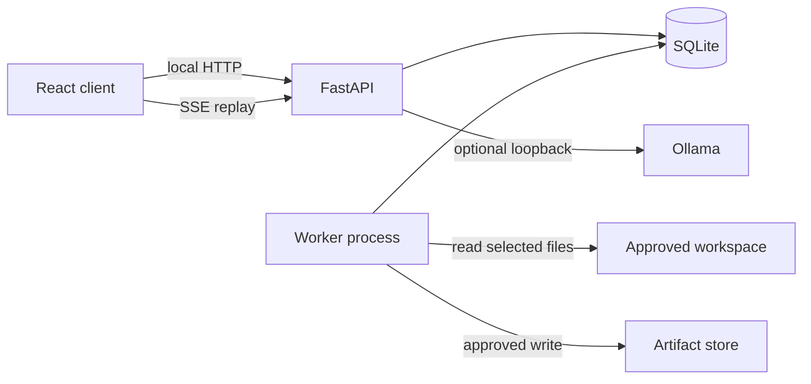

# Architecture

NEXUS is a local-first, single-owner application. React and TanStack Query
use a loopback FastAPI service. SQLite holds tasks, plans, approvals, execution
receipts, events, artifact metadata, and worker heartbeats. A separate worker
executes only allowlisted tools. Ollama is optional; deterministic demo mode
uses synthetic fixtures.

The API validates task input and plans before saving them. A plan step names
one registered tool and typed arguments. The worker claims a queued task with
`BEGIN IMMEDIATE`, checks the task's capability grant and argument hash, then
records the execution. Read attempts may be retried after a lease expires,
up to three total attempts.
An uncertain report write stops for manual review.
The recovery API reconstructs expected report bytes from verified read
receipts. An operator may accept an existing byte-for-byte match or mark a
missing report as absent; mismatched files remain blocked.

`write_report` needs a one-hour approval whose scope includes task, plan
version, step, and argument hash. Immediately before the write, the worker
locks the SQLite transaction and rechecks the task state and approval. Reports
are created exclusively under the app data directory, with a SHA-256 digest.
Each report cites the line range and recorded digest of its source text;
the worker verifies each read receipt before report creation.
Downloads verify both the path boundary and digest. Events are committed to
SQLite before the SSE endpoint emits them, and clients can replay by cursor.

The [tool registry](../services/api/app/registry.py) declares each tool's
parameters, output schema, risk, retry mode, attempt limit, and resource
bounds. The current
implementation supports selected text files and Markdown reports. The
declared tool timeout is not yet a hard process timeout. A persisted task
deadline defaults to one hour and prevents new actions after expiry. It does
not interrupt an in-flight tool. External network fetch remains future
security work.
