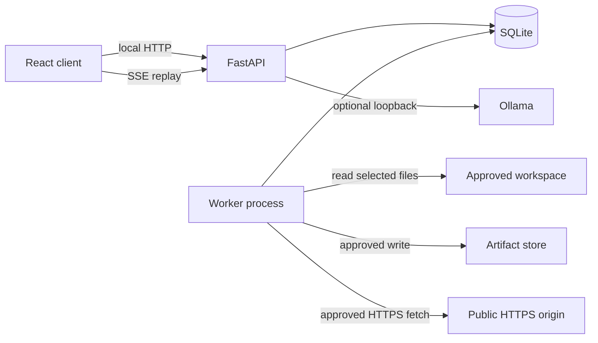

# Architecture

NEXUS is a local-first, single-owner application. React and TanStack Query
use a loopback FastAPI service. SQLite holds tasks, plans, approvals, execution
receipts, events, artifact metadata, and worker heartbeats. A separate worker
executes only allowlisted tools. Ollama is optional; deterministic demo mode
uses synthetic fixtures.

The API validates task input and plans before saving them. A plan step names
one registered tool and typed arguments. The worker claims a queued task with
`BEGIN IMMEDIATE`, checks the task's capability grant and argument hash, then
records the execution. Read attempts may be retried after a lease expires,
up to three total attempts.
An uncertain report write stops for manual review.
The recovery API reconstructs expected report bytes from verified read
receipts. An operator may accept an existing byte-for-byte match or mark a
missing report as absent; mismatched files remain blocked.
After an accepted report, dependent steps are requeued while the deadline is
valid. A real process-kill test covers the write, rollback, review and
reconciliation sequence.

`write_report` and `fetch_url` need a one-hour approval whose scope includes task, plan
version, step, and argument hash. Immediately before the write, the worker
locks the SQLite transaction and rechecks the task state and approval. Reports
are created exclusively under the app data directory, with a SHA-256 digest.
Each report cites the line range and recorded digest of its source text;
the worker verifies each read receipt before report creation.
Downloads verify both the path boundary and digest. Events are committed to
SQLite before the SSE endpoint emits them, and clients can replay by cursor.
The execution table also stores the registry version used for each call.
The API exposes bounded receipts without returning read-file contents.

The [tool registry](../services/api/app/registry.py) declares each tool's
parameters, output schema, risk, retry mode, attempt limit, and resource
bounds. The current implementation supports selected text files, bounded public
HTTPS text fetches and Markdown reports. The
production worker supervises each action in a child process. It starts the
registry timeout when the child enters the tool, terminates a stalled child,
and records a durable timeout outcome. Uncertain writes still require report
reconciliation. A persisted task deadline defaults to one hour and prevents
new actions after expiry. HTTPS fetch is an explicit per-task grant and an
exact-step approval. DNS answers must all be public, the connection pins the
validated address with the original TLS hostname, redirects remain on the
same origin, and responses are bounded. An uncertain fetch outcome stops for
review without automatic replay.

Local document search uses a read-only `SearchProvider` boundary. The only
production provider is the reviewed Markdown/text scanner, which calls the
same selected-workspace reader as `read_file`; no runtime third-party provider
loading is enabled.
